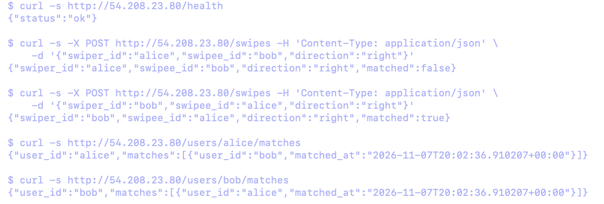
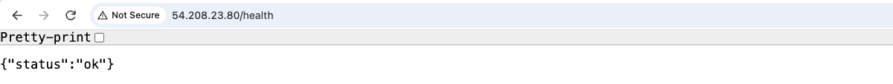
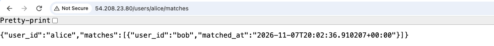
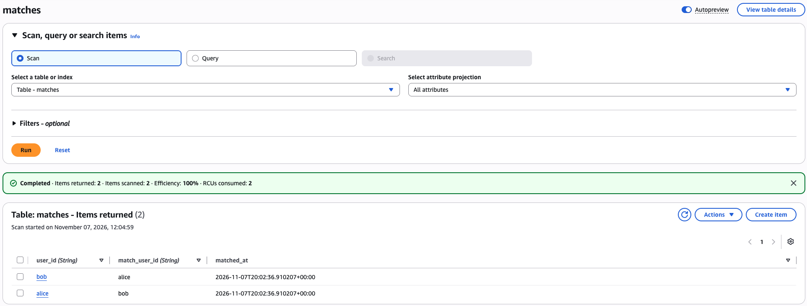
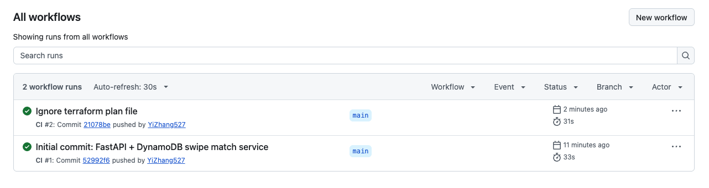

# Swipe Match Service

FastAPI + DynamoDB service that records swipes and detects mutual matches. Everything runs in Docker.

## API
- `POST /swipes` — `{"swiper_id": "alice", "swipee_id": "bob", "direction": "right"}` → returns `matched`
- `GET /users/{id}/matches`
- `GET /health`

## Data model
- `swipes`: PK `swiper_id`, SK `swipee_id`
- `matches`: PK `user_id`, SK `match_user_id` — one item per side, written in a single transaction

## Local
```bash
docker compose run --rm test        # run tests (moto)
docker compose up --build           # API + DynamoDB Local + Nginx at http://localhost:8080
```

## Deploy (AWS Academy)
```bash
./scripts/aws.sh sts get-caller-identity
cp terraform/terraform.tfvars.example terraform/terraform.tfvars   # fill in IP and repo URL
./scripts/tf.sh init
./scripts/tf.sh apply
curl http://<public_ip>/health
./scripts/tf.sh destroy
```

## Demo

Deployed to AWS EC2 with Terraform and verified end to end, then torn down with `terraform destroy`.

Mutual right swipes create a match; both users see each other in their match list:



Health check and match lookup served through Nginx on EC2:





Match records stored in DynamoDB, one item per user, written in a single transaction:



Tests run automatically in GitHub Actions on every push:


